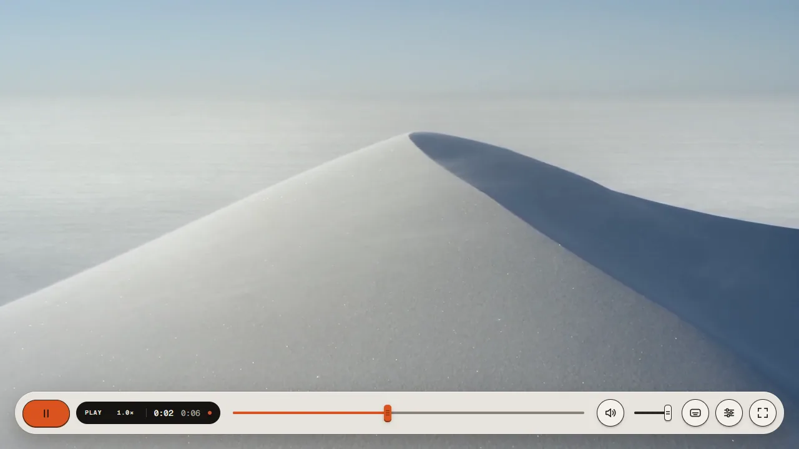
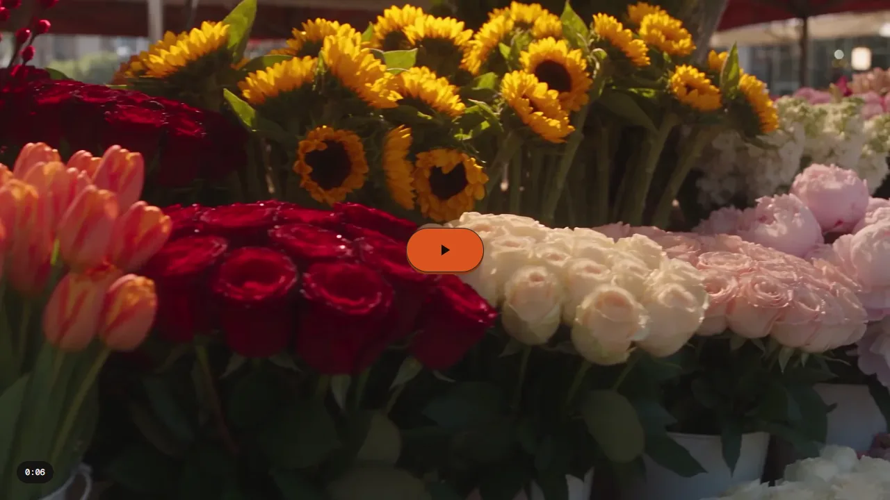
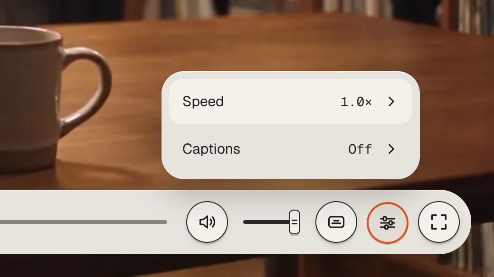
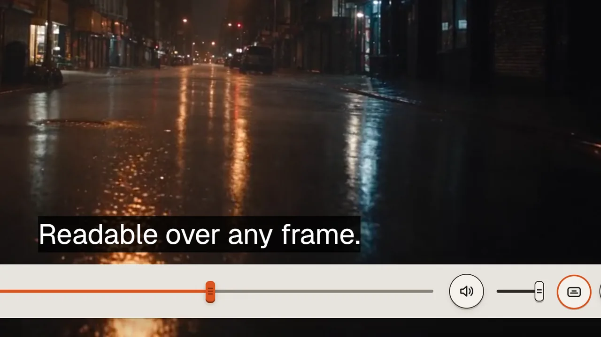
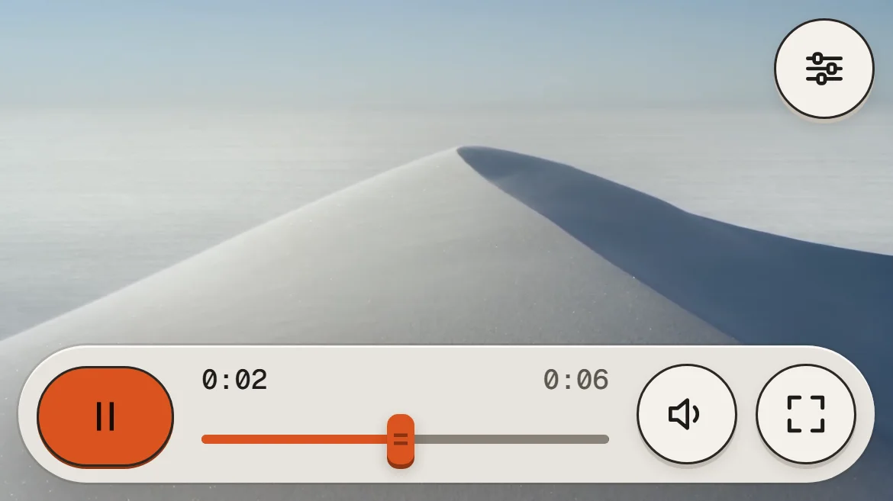

# Tactile — Paper Key

A Video.js 10 skin built like a desk object: keys that latch, faders that scrub, a display that holds state. HTML
custom elements and CSS, three glazes, any accent, keyboard first, readable over any frame.

**Live page:** https://tactile-paper-key.vercel.app · by [promopark.studio](https://promopark.studio) · Apache 2.0



## Install

```sh
npm i @videojs/html@10
npx degit promoparkllc/tactile-paper-key/src tactile-skin   # skin.css + styles/ + video/ into ./tactile-skin
```

Or clone the repository and copy its `src/` folder:

```sh
git clone https://github.com/promoparkllc/tactile-paper-key.git
```

```js
import '@videojs/html/video/player'; // <video-player>
import './tactile-skin/video/skin'; // the skin: its elements, the icon family, the status display, the seek preview
import skin from './tactile-skin/video/skin.html?raw'; // or paste skin.html's markup inside <video-player>

const player = document.querySelector('video-player');
player.innerHTML = skin.replace('<!-- Add a compatible media component here. -->', '<video src="clip.mp4" playsinline></video>');
```

The skin works with any Video.js 10 media element (`<video>`, `<mux-video>`, …). The page loads Geist and Geist Mono
itself (`src/skin.css` shows how); without them the skin falls back to the system UI stack. Tested from the public
repository in an empty Vite project: the two commands above, this snippet, `vite build`, then play, menu and keys in
Chrome.

## Use

- `data-glaze="graphite"` or `"stone"` on the player's `media-container` swaps the material (default: bone). Every
  part follows: dock, keys, lines, menu, tooltips, focus ring.
- `--media-accent-color` (default `#D9531E`) and `--media-accent-text-color` set the light: the Play key, the seek
  fill and cap, the rim of a latched key.
- `--media-font-family`, `--media-border-radius`; `--tactile-scale` scales the whole controls layer (the skin sets
  1.25 in fullscreen on screens from 1280 px); `visibility="always"` on `media-controls` pins the dock.
- Keyboard: Space / K play, ← → seek 5 s, ↑ ↓ volume, M mute, F fullscreen, C captions, Esc closes any menu and hands
  focus back. Every key has a tooltip with its name and shortcut; the status announcer reports state changes.

| state | |
| --- | --- |
|  |  |
|  |  |

Before the first play there is no dock: one large Play key on the poster and the duration. While the media stalls the
display reads `LOADING` with three stepping LEDs; at the end the large key returns as Replay over `END`; a failed
source shows `NO SIGNAL` with a Try again key. Under 560 px the dock drops to 60 px with Settings in the corner.

## Glazes, measured

| glaze | glyph on key | lines and ring on dock | accent fill on dock | buffer on dock |
| --- | --- | --- | --- | --- |
| bone | 15.1:1 | 11.7:1 | 3.2:1 | 3.0:1 |
| graphite | 9.2:1 | 11.6:1 | 3.5:1 | 4.7:1 |
| stone | 9.4:1 | 6.9:1 | 1.6:1 by itself → a 1 px ink keyline around the fill, cap and the rim of a latched key (6.9:1) | 3.7:1 |

All tokens live in `src/styles/themes/tactile.css`; the glaze blocks only override them.

## Accessibility

axe-core (WCAG 2.1 A/AA) on the page and on the player alone, desktop and 390 px, menus open: **0 violations**
(`design/a11y/axe-report.md`). Focus ring 2 px with a 3 px gap, separate from the pressed state; 44 px targets
everywhere; forced colours map keys, accent rims and focus to system colours; reduced motion keeps every state change
without travel. Captions are a sidecar track, never burned in.

## Develop

```sh
npm install
npm run dev          # the page at /, the workbench at /workbench.html, the lab player at /lab.html
npm run typecheck
npm run build
node apps/preview/scripts/capture-states.mjs   # the twelve state captures (Playwright, real player)
node apps/preview/scripts/axe.mjs              # the audit → design/a11y
node apps/preview/scripts/shots.mjs            # page captures at 1440 / 810 / 390 → design/implementation
```

`npm run deploy vercel` deploys the page (also Netlify or Cloudflare Pages; `vercel.json` and `netlify.toml` describe
the build). The workbench (`/workbench.html`) is Video.js's skin sandbox: width, ratio, colour scheme, direction,
language and playback options in the URL; change its media in `apps/preview/src/frame/player.ts`.

## Where things live

- `src/`: the skin, and only the skin. `src/video/` holds `skin.html`, `skin.ts` (elements, icons, `tactile-status`,
  `tactile-seek-preview`) and `skin.css`; `src/styles/` the base styles and the `tactile` tokens (glazes included).
- `apps/preview/`: the page (`index.html`, `src/showcase/`), the lab player, the workbench, the captures and the
  scripts; `public/` holds the fonts, the demo footage (720p cuts), the state captures and the posters.
- `design/`: the design sources (`*.dc.html`: Final, States, PageV3 …), the spec, the fidelity report, the
  implementation captures and the a11y report.
- `film/`: the 26 s explainer that plays in the hero (Blender build scripts and brief, the Remotion layer and sound in
  `film/motion` and `film/audio`; renders are not in the repo).
- `skin.json`: what this skin was created from (Video.js 10.3.0 scaffold, HTML, CSS).

Design sources: `design/Final.dc.html`, `design/States.dc.html`, `design/PageV3.dc.html`. Spec: `design/spec.md`.

## Learn more

- [Build your own skin](https://videojs.org/docs/framework/html/guides/build-your-own-skin)
- [Customize skins](https://videojs.org/docs/framework/html/guides/customize-skins)
- [UI components](https://videojs.org/docs/framework/html/guides/ui-components)

## License

Apache 2.0 (see `LICENSE`). The demo clips in `apps/preview/public/footage/` were generated for this showcase and are
not covered by that license; do not redistribute them (see the `NOTICE.md` beside them). The fonts (Geist, Geist
Mono, Michroma, Instrument Sans) are under the SIL Open Font License 1.1; each font folder has its `OFL.txt` and a
`LICENSES.md`.

Made by Promopark Studio for the Video.js Skins Design Challenge.
