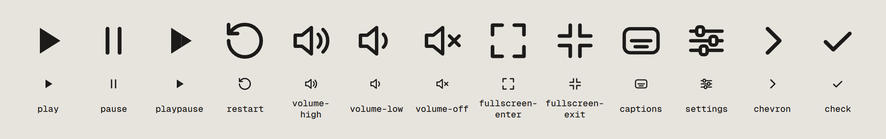

# Fidelity report · implementation vs `design/Final.dc.html`

Captured 2026-11-09 from the workbench (`/preview.html`) with headless Chromium, player width 1200 (board size),
762 (810 viewport) and 390. Distances read from `getBoundingClientRect()`. The screenshots behind this report stay
in the working repository; the public one carries the icon sheet only, so states are described here, not linked.

## Accent rim and menu scrolling · 2026-11-10

Two fixes after a recording on the live site. The latch bar rows and notes in the next section describe what this
replaced.

| Item | Asked | Measured | Status |
| --- | --- | --- | --- |
| Latched key rim | 2px `--media-accent-color`, key 1px down, glyph ink, no bar | border 2px `rgb(217 83 30)`, key 44 × 44, 1px down, glyph ink, no `.tactile-led` in the DOM | matched |
| Focus over a latched key | 2px ink ring, 3px offset, separate | outline 2px ink + 3px with the rim inside it (captured on the three glazes) | matched |
| Forced colours | rim = Highlight | border `Highlight`, ring `Highlight` (captured in forced colours) | matched |
| Rim against the dock | ≥ 3:1 on the three glazes | bone 3.18, graphite 3.51, stone 1.61 | stone: see below |
| Scrollbar while a submenu opens | 0 frames | 0 of 1741 screencast frames (before: 154 of 1613) | matched |

- **Stone.** The burnt orange is 1.6:1 on the stone dock, so the rim alone cannot reach 3:1 there (the same limit
  the glaze already has for the fill). Stone draws its 1px ink keyline around the rim: 6.9:1 against the dock and
  4.3:1 against the rim. The alternative, a darker rim (`#8F3210`, 3.2:1), would not be the accent colour.
- **Rim against the key face** (the inner edge): bone 3.55, graphite 2.77, stone 2.18. The state is also carried by
  the 1px latch and by `aria-pressed` / `aria-expanded`.
- **Scrollbar test.** Chrome with scrollbars on (headless hides them by default, which is why the first build's
  check saw none), the menu's scrollbar painted magenta for the test, a CDP screencast of every painted frame while
  Quality, Speed and Captions were each opened ten times, and every frame searched for scrollbar pixels. A second
  witness inside the page counted frames in which a page was a scroll container that overflowed. Desktop (player
  1200): 0 of 1741 frames, 0 of 3009 probe frames; the same test on the build before the fix found 46 / 58 / 50
  frames for Quality / Speed / Captions and 407 probe frames. The screencast delivers painted frames, about 31–35
  per second on this desktop run and 60 on the 390 run.
- **390 (touch).** Speed (311px of rows in a 135px page) and Captions (161px in 135px) do not fit under the corner
  key in a 219px player, so they scroll; the scrollbar was on in 0 frames while the panel or a page was moving and
  only after it settled. Quality is not in that menu outside fullscreen.
- **Corner menu taps.** While testing at 390, the corner menu's rows turned out not to take taps or clicks: the
  panel inherited `pointer-events: none` from the controls layer (the dock's menu sits inside the dock, which
  turns them back on). The panel now sets `pointer-events: auto`. This was live before the fix.

## States, dock size B, latch bar · 2026-11-10

Against `design/States.dc.html` and the brief of 2026-11-10 (the dock size and active key boards were not in the
repo; their values come from the brief). Captured from the production build with Chrome, player 1200 × 675 and
390 × 219 (touch, DPR 2). Every new state was captured at both sizes; the 1440 / 810 / 390 set, the preference
captures, the icon sheet and the ×4 cap close-ups were retaken on the 68px dock. Sections below this one describe
the first build (88px dock) where they give dock, key, pill or cap sizes.

| Item | Asked | Measured | Status |
| --- | --- | --- | --- |
| Dock / radius / padding / gap | 68 / 34 / 12 / 10 | 68 / 34 / 12 / 10 (dock x 24, play x 36, pill x 122) | matched |
| Keys / play / pill | 44 / 76 × 44 / 36 high | 44 × 44 / 76 × 44 / 231 × 36 | matched |
| Seek cap / volume | 12 × 26 / proportional | 12 × 26, three ribs / 72 wide, cap 12 × 26 | matched |
| Hit areas | ≥ 44 | keys 44 × 44, seek and volume faders 44 tall, big key 112 × 64 | matched |
| Fullscreen scale | capped at ×1.25 | `--tactile-scale` 1.25 from 1280px: dock 85, keys 55, inset 30 | matched (token applied by hand; headless cannot enter fullscreen) |
| READY | big key 112 × 64 centred, duration pill, no dock | 112 × 64 centred, `0:26` pill 53 × 32 at 24 / 24, dock `visibility: hidden` | matched |
| LOADING | `LOADING` + 3 LEDs, 300ms steps, after 400ms | one LED lit per 300ms (sampled 010 001 001 100 100 010), `delay="400"` | matched |
| Seek preview | 176 × 99 bezel, r12, 1.25 ink, pill under, hairline | 176 × 99, frame 165.5 × 88.5 r8, pill 53 × 26, hairline 1.5 × 20, 14px above the dock | matched |
| Tooltip | name + chip, 500ms hover, at once on focus | opens between 432 and 541ms on a cold hover, at once on focus, never from touch | matched |
| END | big key + `END 0:26 / 0:26`, dock down until the pointer moves | key and pill centred as one column, dock opacity 0 until activity | matched |
| ERROR | `NO SIGNAL` + sentence + `Try again` | alert dialog over the frame, focus on the key | matched, see below |
| Latch bar | 13 × 2.5, r2, 6px from the bottom edge | 13 × 2.5, r2, centred (dx 0), 6px (5.75 after pixel snapping) | matched |

Differences, with reasons:

- **Error announcement.** The board says "announced through the status announcer". The error screen is the
  `media-error-dialog`, which makes the rest of the player inert while it is open, the announcer included, and
  `media-status-announcer` has no way to speak a custom message. The popup is `role="alertdialog"`, labelled by
  `NO SIGNAL` and described by the sentence, and it takes focus, so screen readers announce it at once.
- **LOADING pill keeps the times.** The board's pill shows `LOADING` and the LEDs only. The implementation swaps the
  label and puts the LEDs in the rate's cell, so the pill keeps its width and the seek fader does not move.
- **LOADING under 760px.** No status pill in the dock there, so the display floats in the middle of the frame
  (captured at 390).
- **Dim.** The board dims the frame for LOADING and END (brightness .6 / .55); the skin lays `rgb(21 20 19 / .45)`
  over it. Off in forced colours.
- **END on mobile.** The dock rests while paused on mobile (first build), so at the end it stays down; the big key
  restarts.
- **Hairline and preview position.** Both follow `--media-slider-pointer`, which the slider insets by half a cap at
  each end (`thumb-alignment="edge"`), so within 6px of the fader's ends they sit where the cap will land, up to 6px
  from the pointer.
- **Preview crop.** The storyboard tile is 16:9 (165.5 × 91 at this width); the 88.5px opening crops 1.25px top and
  bottom.
- **Tooltip text.** The label is the accessible name, so the Captions key reads "Enable captions" / "Disable
  captions" and Fullscreen "Enter fullscreen" / "Exit fullscreen" (the board writes the short names). The play key
  shows two chips, `K` and `Space`.
- **Latch bar scope.** Bone keys only (captions on, settings open). The play key is the accent colour itself, so a
  bar in that colour would not show; it stays latched 1px down with the pause glyph. Settings open keeps its darker
  face from the first board.
- **Thresholds.** 960 / 800 became 880 / 760. Seek fader width at the edges: 163 at 880, 244 at 879, 125 at 760,
  373 at 759; the 810 capture (player 762) shows the pill with a 127px fader, no overflow at any width from 560 to
  1392.

Checks, 2026-11-10:

- Keyboard: READY Tab order container → big key → out of the player. K, Space or Enter start playback and focus
  lands on the dock's play key with its ring. Then play → seek → mute → volume → captions → settings → fullscreen,
  each key showing its tooltip on focus. END: Space on the container restarts (t = 1.15s a second later).
  ERROR: focus on `Try again`, Enter retries.
- 390 (touch): READY, tap to play, no tooltip from touch, preview while dragging the fader and gone on release,
  PAUSED pill, END, corner menu with the latch bar.
- Reduced motion: LEDs `animation: none`, all dim; centre key scale 1 (fade only); hide offset 0.
- Forced colours: tooltip, preview bezel, LEDs, latch bar and error screen on system colours
  (captured for focus, menu, END and error).
- Error: wrong playback ID with the Mux host blocked opens the screen; retry while still broken returns to it;
  with the network back, `Try again` loads the film (readyState 4, duration 26.07).
- Loading: slow 3G (400 kbps, 400ms latency); the indicator appeared 5.4s after play, when the preloaded buffer ran
  out.
- Lighthouse 13.6 on production after the deploy: mobile performance 99 (LCP 1.5 s, CLS 0, TBT 120 ms), desktop 99
  (LCP 0.7 s, CLS 0); accessibility, best practices and SEO 100 on both. Before: mobile 73 (LCP 4.9 s), desktop 81
  (CLS 0.29). The LCP element is the poster in the HTML. With the web fonts held back 1.5 s the swap moves the page
  by 0.0006 (fallbacks sized on the page text: Michroma 146 %, Instrument Sans 100.5 %).
- Pages: `/`, `/preview.html` and `/workbench.html` all request playback ID `6FsjtrlJ…` from Mux and read 0:26
  (both pages captured at 1440). The 1:51 duration and the black frame were in the captures of
  2026-11-09, taken with the old trailer; those files are replaced.

## Measured against the board (player 1200 × 675)

| Item | Board | Implementation | Status |
| --- | --- | --- | --- |
| Dock inset / height | 24 / 88 | 24 / 88 (dock x 24, w 1152) | matched |
| Dock padding / gap | 18 / 14 | 18 / 14 (play x 42, pill x 152, seek wrap x 410) | matched |
| Play key | 96 × 52, r26 | 96 × 52, r26 | matched |
| Status pill | h 44, pad 18, gap 14 | 244 × 44 | matched (width follows the real duration) |
| Keys | 52, outline 1.25, face `#F3F0EB`, shade 0 2px 0 `#C2BBB1` | same tokens | matched |
| Volume | 84 wide | 84 wide, 68 slider + 8 padding | matched |
| Seek line / fill / buffer | 2 / 4 / 4 | 2 / 4 / 4 | matched |
| Seek cap | 14 × 32, 4 ribs | 14 × 32, 4 ribs (gradient) | matched |
| Menu right / bottom edge | 96 / 124 from the player edge | 96 / 124 (align offset 12, side offset 30) | matched |
| Menu width / radius / padding | 272 / 24 / 8 | 272 / 24 / 8 | matched |
| Menu row height / radius | 48 / 14 | 48 / 14 | matched |
| Highlighted row | `#F3F0EB` + inset 1.25 `#2A2724` | same | matched |
| Focus ring | 2px `#2A2724`, offset 3 | same, on keys, caps and the container | matched |
| Mobile dock | inset 8, h 60, keys 44, play 60 × 44 | 8 / 60 / 44 / 60 × 44 (seek 130 wide at 390) | matched |
| Mobile paused | Play 112 × 64 centred, PAUSED pill 32 tall at 12 / 12 | 112 × 64, pill 146 × 32 at 12 / 12 | matched |
| Mobile cap | 12 × 22, 2 ribs | 12 × 22, 2 ribs | matched |

## Differences, with reasons

- **Time format.** The board writes `01:24` / `04:10`; Video.js `media-time` pads minutes only when hours show, so the
  skin reads `1:24` / `4:10`. Deliberate: the component owns formatting and i18n; no custom time display.
- **Duration.** The board shows 4:10; the media (the Tactile film on Mux) is 0:26. Media, not skin.
- **Menu open + focus on Mute.** The board shows both at once. Video.js menus close when focus leaves them, so the
  two states are captured separately (menu open; focus on Mute). Deliberate: library behaviour.
- **Paused on desktop.** Not on the board. The pill reads `PAUSED 1.0×`, play key unlatched with the play glyph.
  Derived from the mobile paused pill.
- **Speed submenu.** Five rates (0.5×, 1.0×, 1.25×, 1.5×, 2.0×, set with `rates` on the radio groups) so the list
  fits a desktop player without scrolling. Labels are formatted `1.0×` to match the pill. After picking a rate
  the menu returns to its root page and stays open (library behaviour); Escape closes it.
- **Menu rows (2026-11-09, on request).** Hover or keyboard highlight = key face `#F3F0EB` only; selected = the
  check only; focus ring only on `:focus-visible`, and not when the menu was opened with the pointer (the skin
  records the last input kind on the container as `data-input`). The board's inset outline on the highlighted
  row is gone.
- **Menu scrolling (2026-11-09, on request).** Content pages sit 8px inside the panel; `overflow` is hidden while
  the panel opens, closes or slides between pages and `hidden auto` afterwards, so no scrollbar flashes (10 opens,
  100 samples, 0 scrollbars). Where a small player still needs one, it is thin (`scrollbar-width: thin`, hairline
  colour; `::-webkit-scrollbar` 6px, no buttons) and clear of the 24px radius.
- **Fader caps (2026-11-10, second pass after Dorin's live capture).** The capture showed the ribs sitting right
  of the cap's centre, which reads as the cap trailing the fill. Diagnosis in real Chrome (156, rAF sampling at
  DPR 1 / 1.25 / 1.5 / 2): the DOM geometry was already exact; cap and fill read the same variable
  (`--media-slider-fill`, `--media-slider-pointer` while dragging), nothing in the v10 base styles transitions or
  animates `left`, `translate`, `transform` or `inset-inline-start` on the thumb or track, and cap centre − fill end
  was 0.000px in every frame. The ribs were the problem: a gradient positioned `center / 8px` gets its image rect
  rounded to device pixels separately from the cap box, so at fractional positions the ribs sat up to 0.6px off
  centre and jittered as the cap moved (±0.4px at DPR 1 and 2, a constant +0.38px at DPR 1.5), on the `::after`
  and on the thumb itself alike. Now the ribs are an SVG `background-image` on the thumb, sized `100% 100%`
  (`--tactile-cap-ribs`, `-mobile`, `-volume` in the theme; the volume cap paints it from the border box), so
  they share the cap's snapped rect. Measured: rib centroid − body centroid ≤ 0.05px at 16 fractional positions
  and during playback, fast drag and hover, on both faders, at all four DPRs; cap centre − fill end = 0.000px in
  every sampled frame; hover never moves the cap (0 moved frames); the only transitions on the cap are the
  vertical grab lift and the shadow. The visible fill stops at the cap's left edge by design: it ends under the
  cap's centre. Checked on ×4 captures of both caps.
- **Quality row.** Shows because the Mux stream has several renditions (`Auto (720p)`); hides itself on sources with
  one rendition, as the brief asked.
- **Intermediate widths.** The board has no 810 state. Under 960px the volume fader hides, under 800px the pill
  hides and the times sit above the seek fader (mobile pattern with desktop keys). Derived; captured at 810.
- **Buffer colour.** The board's `#A49D93` is 2.1:1 on the dock. Changed (2026-11-09, on request) to `#888177`, the
  lightest grey of the same warm family (same +17 red-over-blue offset) that reaches 3:1 (measured 3.03:1).
  `prefers-contrast: more` still darkens it to `#6F685E`.
- **Mobile Settings key (added on request, not on the board).** Under 560px a 44 × 44 key in the top-right corner,
  inset 8px, same key style, placed after Fullscreen in the DOM and in the Tab order. It has its own menu (same rows:
  Speed, Captions, Quality) that opens downward, 8px below the key, right edges aligned, `transform-origin: top
  right`. Captions is reached through this menu on mobile. The key fades and slides 8px up with the dock when the
  controls hide, and rests with the dock while paused. Measured at 390: key 44 × 44 at top 8 / right 8; menu
  `data-side="bottom"`, 272 wide, 8px gap, right delta 0.
- **Mobile menu rows (2026-11-09, on request).** Outside fullscreen the corner menu shows Speed and Captions only;
  the Quality row is hidden (`:scope:not(:fullscreen)` inside the < 560px query) and comes back in fullscreen.
  Measured in a 390 × 219 player: menu 272 × 114 (8 padding + 48 + 2 + 48 + 8), top 61, 44px left under it, no
  scrolling (scrollHeight = clientHeight = 114), rows 48px. Fullscreen itself cannot be entered headless; the rule is
  the `:fullscreen` exception on the container, which the base theme already uses for the frame radius.
- **Icons.** Board glyphs reproduced exactly (coordinates copied from the board SVGs, which are the project's own).
  volume-off, fullscreen-exit, restart and check are derived on the same grid and weights; see the icon
  sheet below.
- **Container focus ring.** The player container is focusable (Video.js). Its ring uses the ink/bone double ring so
  it reads over bright and dark frames. In the headless touch run it appears after a synthesized tap
  (the 390 playing captures); real pointer and touch focus does not match `:focus-visible` in Chromium.

## Checks

- Keyboard only: Tab order container → play → seek → mute → volume → captions → settings → fullscreen (visual order).
  Mobile (390): container → play → seek → mute → fullscreen → corner Settings; Enter opens the menu downward, arrows
  and Enter reach the Captions submenu and pick a track, Escape closes and returns focus to the corner key.
  Space/Enter on keys, arrows on caps (1s / 5%), hotkeys Space, K, ←/→ (10s), M, F, C on the container. Menu: Enter
  opens, arrows move, Enter opens a submenu, Escape returns then closes, focus back on the Settings key.
- Dock stays visible while anything inside it has keyboard focus; hides 2s after pointer idle while playing.
- Touch targets: 1440 → 96 × 52, 52 × 52 keys, seek 366 × 52, volume 68 × 52. 390 → 60 × 44, 44 × 44, seek 130 × 44
  (pseudo-element hit area), big Play 112 × 64.
- Contrast (surfaces are opaque, so the frame does not change them): ink on key 13.1, ink on bone 11.7, accent fill
  on bone 3.2, buffer on bone 3.03, play glyph on accent 4.8, pill text 16.3, pill duration 7.3, menu text 13.5,
  mobile duration 5.7, LED 3.6. Dock edge over a white frame 1.3 (hairline + shadow; keys inside carry the boundary); `prefers-contrast:
  more` adds a 1px ink ring.
- Reduced motion: press depth 0, hide offset 0, menu scale 1, morph 0ms, cap lift 0; latched 1px, LED and icon swap
  stay (captured with the menu open).
- Forced colors: Canvas/ButtonFace/Highlight tokens, 1px CanvasText dock and menu borders, Highlight focus ring
  (captured for focus and menu).
- Motion: play↔pause `d` morph verified (paused and playing paths differ, `CSS.supports('d', ...)` true); press
  translate 2px → 0; latched play key 1px.

## Showcase page · implementation vs `design/ShowcaseV2.dc.html`

Captured 2026-11-09 at 1440 / 810 / 390 (full pages), recaptured from production 2026-11-10 with the film.
Lighthouse on production 2026-11-10 (13.6): mobile accessibility 100, best practices 100, SEO 100, performance 73
(LCP 4.9 s on the poster image behind the Google Fonts CSS, which blocks render ~0.9 s); desktop performance 81,
CLS 0.29 from the Michroma web font swapping in on the "Test it" section (fonts unchanged since launch). Reported,
not changed.

- **Structure, type, colours, spacing** follow the board: header, h1 64px Michroma with the outlined span, 16:9 hero
  with radius 16, 20px lede (max 620), cream "Test it" bar (24/28 padding, radius 6, 44px title, 48px chips, 44px
  swatches, `kbd` legend), scanline section with the amber band, 2-column frames grid with the wide flatten frame,
  stats box with the ticker row and the 3-column grid, 76px footer. Narrow (container ≤ 700px): h1 34, titles 26,
  footer 30, single-column grids, stacked test bar.
- **Hero.** The board's mock dock over a still is the real Video.js v10 player with the skin (`--media-border-radius:
  16px`). The poster (`POSTER_SRC`) is frame 45 of the final film (the dark hook, no UI, `poster.webp` 1920 px);
  the flatten frame would double the dock. The media is the film on Mux (playback ID in `VIDEO_SOURCE`,
  2026-11-10), with `captions.en.vtt` (one cue per shot 4–8, off by default) as the one text track.
- **H1.** Two intended lines on desktop, "A PLAYER" / "YOU CAN PRESS", via a ` `; under 700px the break is
  removed and `text-wrap: balance` keeps the words paired (390: "A PLAYER YOU" / "CAN PRESS").
- **Test bar.** Daylight / Night seek to `DAY_T` / `NIGHT_T` (12.5 s, the flatten at mean luma 206/255; 20 s, the
  display macro at 41/255) and play; the chip label times come from the constants. Swatches are `<button aria-pressed aria-label>` and set `--media-accent-color` and
  `--media-accent-text-color` on the player. Tab order: player controls → Daylight → Night → four swatches.
- **Images.** `frame-flatten.webp`, `frame-key.webp`, `frame-glazes.webp` (1600 × 900 WebP from film/frames) with the
  board's alt texts. `og.png` 1200 × 630 from the poster frame (film frame 45) plus the title; `favicon.svg` is the
  play key.
- **Differences.** The band grows past 52px at 390 (min-height instead of height) because the 26px title needs two lines; the
  board's fixed 52px clips it. Focus rings are ink, not cream, inside the cream test bar. Headings: h2 for "Test it"
  and "From object to interface", a visually hidden h2 for the stats box. The workbench moved to `/workbench.html`
  so the showcase is the site root.

## Icon sheet · family `tactile`, 18 × 18 grid

| Name | Source | Geometry |
| --- | --- | --- |
| `play` | board | filled triangle `M5.5 3.6 14 9l-8.5 5.4z` |
| `pause` | board | two strokes x 6.5 / 11.5, y 4–14, stroke 1.6 round |
| `playpause` | derived from both | two filled quads whose `d` morphs between the triangle halves and the bars |
| `restart` | derived (2026-11-09) | Lucide `rotate-ccw` scaled 24 → 18: counter-clockwise arc r 6.75, head at the start `M2.25 2.25V6h3.75`, stroke 1.5 |
| `volume-high` / `volume-low` | board | speaker + two arcs / one arc, stroke 1.4 |
| `volume-off` | derived | speaker + cross `M12 7l4 4M16 7l-4 4`, stroke 1.4 |
| `fullscreen-enter` | board | four outward corners in a 13px box (2.5–15.5), stroke 1.5 |
| `fullscreen-exit` | derived (2026-11-09) | the same 13px box, arms turned inward to (7, 7) / (11, 11), stroke 1.5 |
| `captions` | brief 2026-11-10 | rect 14 × 10 r2.5 + two lines against the bottom edge, long over short (`M5 9h8M6.5 11.5h5`), stroke 1.4 |
| `settings` | board | three lines + three knobs filled with the key face (`--tactile-knob`), stroke 1.4 |
| `chevron` | board | `M7 4l5 5-5 5`, stroke 1.6 |
| `check` | derived | `M4 9.5l3.2 3.2L14 6`, stroke 1.6 |

## Showcase · 2026-11-09 additions

- **Test bar actions** (Daylight, Night, swatches) show the dock for 4s through synthetic pointer activity on the
  container (the controls feature has no show-for-duration action; its idle timer is fixed at 2s, so two moves hold it)
  and scroll the player into view (`block: 'nearest'`, no smooth scroll under reduced motion). Measured: visible at
  0.7s and 3.5s after the click, hidden by 6.7s.
- **Pin controls** toggles `visibility="always"` on `media-controls` (`aria-pressed`); the dock stayed up through 3s
  of idle while pinned and hid 2.6s after unpinning.
- **Ticker** above the stats grid: "52 px keys ▶ 13:1 contrast ▶ 70 ms press ▶ Esc closes every menu ▶ Forced colours
  ▶ Keyboard first ▶", Michroma 11px uppercase, separator margins 20px each side. Two copies (the second
  `aria-hidden`), `transform: translateX` only, duration = copy width / 40 so the speed is ~40px/s at any width
  (measured 39.3px/s at 1440; 28.45s per loop at 1440 and 390). Pauses on hover and focus-within; static under
  reduced motion. The rule beneath is inset 20px on both sides; the text is cut clean at the card edges.
